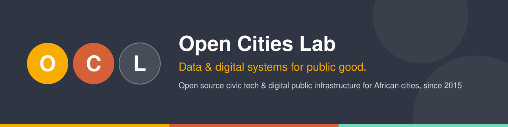

  

  
  
  
  

## 👋 We are Open Cities Lab

**Open Cities Lab (OCL)** is a South African non-profit that has been building **open, reusable data and digital systems with African governments and citizens since 2015.**

We create tools and interventions that **strengthen capacity within government, empower residents and improve trust and accountability in the civic space.** We work alongside institutions to build lasting capacity, not one-off tools.

Our tech is **modular and open source**. It is built on open standards and reuses proven components such as CKAN, X-Road, Decidim and KoboToolbox, so it can be adapted across countries and contexts.

> [!NOTE]
> **Looking for our code? Most of it lives at [github.com/opendatadurban](https://github.com/opendatadurban).**
> Open Cities Lab started life as **Open Data Durban**, and a decade of our repositories still sits under that organisation. This org, `opencitieslab`, is where our new work lands. See [Our history](#-our-history-open-data-durban) below.

---

## 🧭 What we work on

| | Theme | What it means |
|:-:|---|---|
| 🟡 | **Digital Public Infrastructure** | Interoperable data exchange, catalogues and shared platforms for government ([DPI for African Cities](https://www.opencitieslab.org/digital-public-infrastructure/)) |
| 🟠 | **Data for Cities** | Open data portals, data strategy and analytics that help cities plan and deliver services |
| 🟢 | **Civic Participation** | Tools that help residents engage with elections, representatives and local decisions |
| 🔵 | **Responsible Tech** | Standards, toolkits and capacity-building for ethical, inclusive technology in government |

---

## ⭐ Featured open source projects

<table>
<tr>
<td width="50%" valign="top">

### 🗳️ MyCandidate
  

Helps voters find out who is standing for election in their ward and what they stand for. It started at a community civic-tech evening, ran in the South African 2016 and 2021 local elections, and has been **adapted for Kenya, Nigeria and Zimbabwe.**

[`mycandidate`](https://github.com/opendatadurban/mycandidate) · [`ward-candidates`](https://github.com/opendatadurban/ward-candidates) · [Live site](https://southafrica.mycandidate.africa/) · [Product page](https://www.opencitieslab.org/product/mycandidate/)

</td>
<td width="50%" valign="top">

### 🔗 MzansiXchange · X-Road tooling
  

Open components for South Africa's **MzansiXchange** government data exchange: an ecosystem catalogue for browsing X-Road participants, subsystems and services, and a resumable **bulk data transfer** service built on the TUS protocol.

[`xroad-catalog-ui`](https://github.com/opendatadurban/xroad-catalog-ui) · [`mx-xroad-bdt`](https://github.com/opendatadurban/mx-xroad-bdt)

</td>
</tr>
<tr>
<td width="50%" valign="top">

### 🗂️ CKAN extensions
  

Themes and extensions for **CKAN**, the open source data portal used by governments worldwide, including the API catalogue for National Treasury's Secure Data Facility on MzansiXchange.

[`ckanext-sdf-theme`](https://github.com/opendatadurban/ckanext-sdf-theme) · [`ckanext-ocl_theme`](https://github.com/opendatadurban/ckanext-ocl_theme)

</td>
<td width="50%" valign="top">

### 🏙️ SCODA: South African Cities Open Data Almanac
  

A platform that brings together comparable indicators for South African cities, so planners, researchers and residents can explore how cities are changing.

[`scoda`](https://github.com/opendatadurban/scoda) · [Live site](https://scoda.co.za/)

</td>
</tr>
<tr>
<td width="50%" valign="top">

### 📘 City Data Toolkit
 

Tools and guidance for city data teams and chief data officers: an open standard, a manual and a website. It was developed with FCDO funding.

[`cdo-toolkit-standard`](https://github.com/opendatadurban/cdo-toolkit-standard) · [`cdo-toolkit-manual`](https://github.com/opendatadurban/cdo-toolkit-manual) · [`cdo-toolkit-home`](https://github.com/opendatadurban/cdo-toolkit-home)

</td>
<td width="50%" valign="top">

### 🧰 Responsible Tech Toolkit

A practical toolkit based on Responsible Tech Principles. It guides teams that build and deploy technology for government and civil society so that their work has a positive impact on society.

[`responsible-tech-toolkit`](https://github.com/opendatadurban/responsible-tech-toolkit)

</td>
</tr>
</table>

### 🧪 What we're exploring now

| Project | What it is |
|---|---|
| [`decidim-demo`](https://github.com/opencitieslab/decidim-demo) | A [Decidim](https://decidim.org) participatory-democracy platform pilot for African cities ([try it](https://participate.opencitieslab.africa)) |
| [`fleet-management`](https://github.com/opencitieslab/fleet-management) | Evaluating [OpenRemote](https://openremote.io)'s open source fleet telematics for municipal vehicle fleets |

---

## 🧩 Our products

Many of our open source components support these OCL products. [See them all →](https://www.opencitieslab.org/products/)

| Product | What it does |
|---|---|
| [**CivicView**](https://www.opencitieslab.org/product/civicview/) | Data management platform for sharing city data through dashboards, storytelling and publishing |
| [**CityCollect**](https://www.opencitieslab.org/product/citycollect/) | Mobile survey tool built on Kobo, with templates, GPS tagging and photo uploads |
| [**MyCandidate**](https://www.opencitieslab.org/product/mycandidate/) | Helps voters learn about candidates for local office |
| [**MyRep**](https://www.opencitieslab.org/product/myrep/) | Tracks councillor performance between elections |
| [**InfoScout**](https://www.opencitieslab.org/product/infoscout/) | Machine-learning tool that extracts key information from large volumes of text |
| [**SystemLink**](https://www.opencitieslab.org/product/systemlink/) | Reusable scripts that link legacy city systems (SAP, SQL) to modern portals and dashboards |
| [**RateManage**](https://www.opencitieslab.org/product/ratemanage/) · [**VoltManage**](https://www.opencitieslab.org/product/voltmanage/) · [**FlowManage**](https://www.opencitieslab.org/product/flowmanage/) | Tariff modelling and electricity and water infrastructure planning for municipalities |
| [**DataStrat**](https://www.opencitieslab.org/product/datastrat/) · [**DigiServe**](https://www.opencitieslab.org/product/digiserve/) | Data strategy toolkit and digital transformation advisory for government |

---

## 🌍 Initiatives

- **[Digital Public Infrastructure for African Cities](https://www.opencitieslab.org/digital-public-infrastructure/)**: shared, interoperable digital foundations for local government.
- **[Africa Data Hub](https://www.africadatahub.org/)**: data, dashboards and training for journalists across the continent.
- **[MijiBora](https://mijibora.africa/)**: brings city leaders, grassroots innovators and technologists together to co-create better cities.

---

## 📜 Our history: Open Data Durban

Open Cities Lab began in **2015 as Open Data Durban**, a civic-tech community in Durban, South Africa, that ran hack nights, data trainings and early open data projects with eThekwini Municipality. As our work grew to cities and national governments across Africa, we became **Open Cities Lab**.

Our GitHub history came with us. **[github.com/opendatadurban](https://github.com/opendatadurban)** still hosts most of our public repositories, from early projects like the [Durban Budget Project](https://github.com/opendatadurban/durban-budget-project) and [Gibela](https://github.com/opendatadurban/Gibela) to current DPI work. New projects are published here under **[github.com/opencitieslab](https://github.com/opencitieslab)**.

---

## 🤝 Partners & funders

We are grateful for support from the **UK Foreign, Commonwealth & Development Office (FCDO)**, the **Gates Foundation**, **Luminate**, the **Indigo Trust** and the **Constitutionalism Fund**. We work with partners including **National Treasury**, **SALGA**, the **Cities Support Programme**, **eThekwini Municipality**, the **City of Cape Town**, the **City of Johannesburg**, the **HSRC**, the **Open Data Institute**, the **Open Knowledge Foundation**, **Code for All** and **OpenUp**.

---

## 💬 Work with us

- 🌐 **Website:** [opencitieslab.org](https://www.opencitieslab.org/)
- ✉️ **Email:** [hello@opencitieslab.org](mailto:hello@opencitieslab.org)
- 🔗 **Social:** [LinkedIn](https://www.linkedin.com/company/open-data-durban/) · [Instagram](https://www.instagram.com/opencitieslab/) · [Facebook](https://www.facebook.com/opencitieslab)
- 🛠️ **Contribute:** read our [Contributing guide](https://github.com/opencitieslab/.github/blob/main/CONTRIBUTING.md) and [Code of Conduct](https://github.com/opencitieslab/.github/blob/main/CODE_OF_CONDUCT.md)

   
  Open Cities Lab NPC · NPO 255-261 · PBO 930067929 · South Africa

